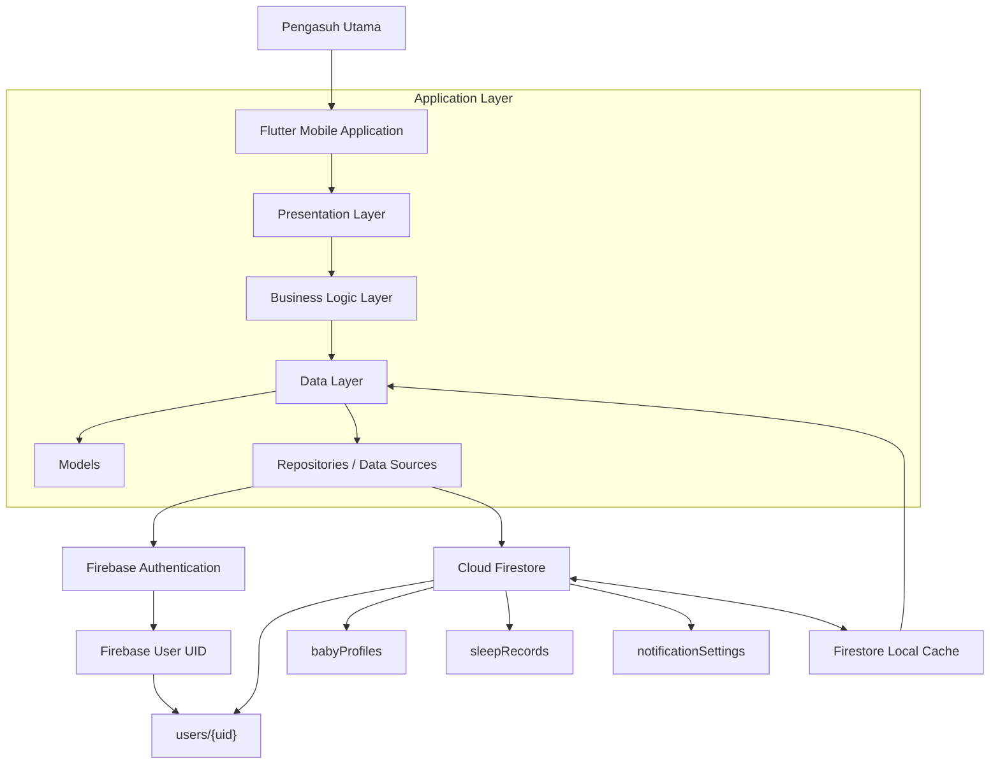
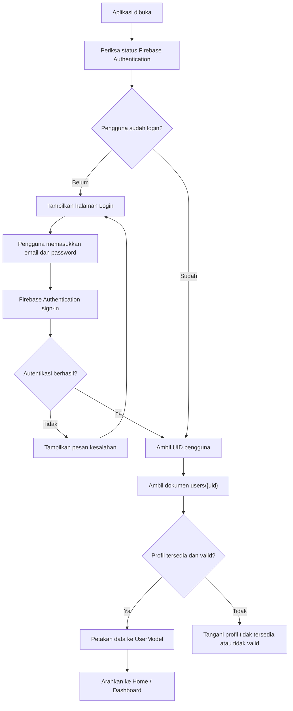
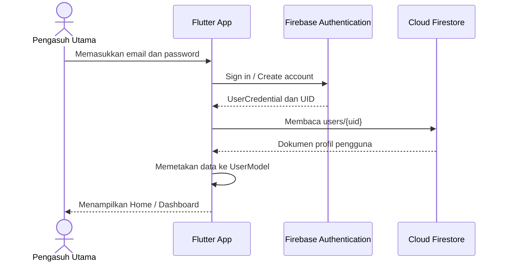
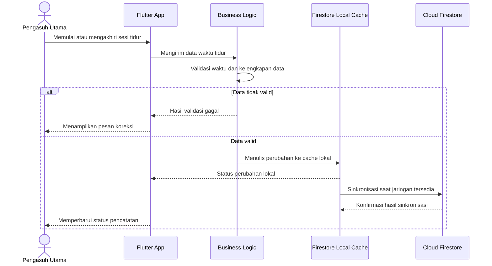
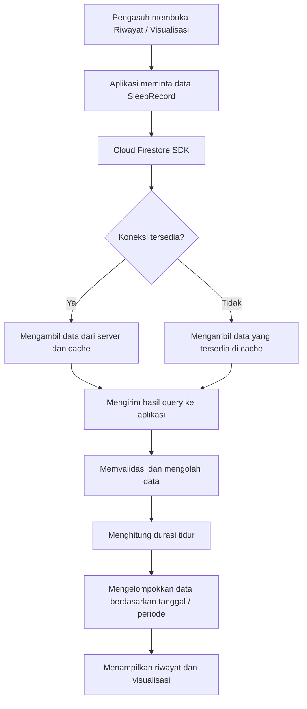

# System Design

# BoboNyenyak

| Informasi              | Detail                                             |
| ---------------------- | -------------------------------------------------- |
| Nama Produk            | BoboNyenyak                                        |
| Jenis Aplikasi         | Mobile Application                                 |
| Framework              | Flutter                                            |
| Bahasa Pemrograman     | Dart                                               |
| Backend Services       | Firebase Authentication, Cloud Firestore           |
| Pendekatan Penyimpanan | Offline-First dengan Firestore Offline Persistence |
| Kelompok               | The Winner (11)                                    |
| Mata Kuliah            | CPA560 – Perancangan Aplikasi Mobile               |
| Institusi              | Universitas Esa Unggul                             |
| Versi Dokumen          | 1.0                                                |
| Status                 | Draft system design                                |

---

## 1. Pendahuluan

### 1.1 Tujuan Dokumen

Dokumen System Design ini menjelaskan rancangan teknis BoboNyenyak, meliputi arsitektur aplikasi, pembagian lapisan, alur autentikasi, integrasi Firebase, rancangan struktur data, keamanan, dan alur pemrosesan data.

Dokumen ini menjadi acuan teknis bagi pengembangan aplikasi agar implementasi antarmuka, logika aplikasi, dan pengelolaan data memiliki pembagian tanggung jawab yang jelas.

### 1.2 Ruang Lingkup Sistem

BoboNyenyak merupakan aplikasi mobile berbasis Flutter yang membantu Pengasuh Utama mencatat waktu tidur dan bangun bayi, mengelola profil bayi, melihat riwayat, serta memahami pola tidur melalui visualisasi informasi.

Sistem menggunakan Firebase Authentication untuk autentikasi pengguna dan Cloud Firestore untuk penyimpanan data aplikasi. Firestore Offline Persistence digunakan untuk mendukung pembacaan data dari cache dan penyimpanan perubahan ketika perangkat tidak memiliki koneksi internet.

### 1.3 Aktor Sistem

BoboNyenyak hanya memiliki satu jenis pengguna aplikasi:

| Aktor                   | Deskripsi                                                                              | Hak Akses                                                                                                                                 |
| ----------------------- | -------------------------------------------------------------------------------------- | ----------------------------------------------------------------------------------------------------------------------------------------- |
| Pengasuh Utama (`user`) | Ibu, ayah, atau anggota keluarga yang aktif merawat dan memantau rutinitas tidur bayi. | Mengelola akun dan profil sendiri, mengelola profil bayi, mencatat tidur, melihat riwayat, melihat visualisasi, serta mengatur pengingat. |

Tidak terdapat fitur Admin Sistem, dashboard administrasi, maupun hak akses administratif dalam ruang lingkup sistem saat ini.

---

## 2. Technology Stack

| Komponen             | Teknologi                     | Tanggung Jawab                                                                             |
| -------------------- | ----------------------------- | ------------------------------------------------------------------------------------------ |
| Mobile Framework     | Flutter                       | Membangun antarmuka dan aplikasi mobile lintas platform.                                   |
| Programming Language | Dart                          | Mengimplementasikan UI, logika aplikasi, model, dan integrasi layanan.                     |
| Authentication       | Firebase Authentication       | Registrasi, login, logout, identitas pengguna, dan pengelolaan sesi.                       |
| Cloud Database       | Cloud Firestore               | Menyimpan profil pengguna, profil bayi, catatan tidur, dan pengaturan pengingat.           |
| Offline Support      | Firestore Offline Persistence | Membaca data dari cache dan menyimpan perubahan ketika offline untuk disinkronkan kembali. |
| UI Design            | Figma                         | Merancang antarmuka, komponen, dan prototype aplikasi.                                     |
| Version Control      | Git dan GitHub                | Mengelola source code dan kolaborasi pengembangan.                                         |

### 2.1 Catatan Teknologi

- Firebase Authentication mengelola kredensial dan identitas pengguna. Password tidak disimpan sebagai field pada dokumen Firestore.
- Cloud Firestore menjadi penyimpanan data utama aplikasi.
- Offline persistence menggunakan mekanisme cache dan antrean sinkronisasi yang disediakan Firestore.
- Sistem tidak menggunakan REST API custom, PostgreSQL, maupun SQLite terpisah pada rancangan teknis yang dipilih di Milestone 2.
- Pengingat menggunakan mekanisme notifikasi perangkat sesuai kebutuhan dan izin sistem operasi. Implementasi package notifikasi perlu ditetapkan pada tahap pengembangan fitur tersebut.

---

## 3. System Architecture

### 3.1 Arsitektur Tingkat Tinggi

BoboNyenyak menggunakan arsitektur client mobile yang terintegrasi dengan layanan Firebase. Flutter bertanggung jawab atas antarmuka dan proses aplikasi, Firebase Authentication mengelola identitas pengguna, sedangkan Cloud Firestore menyimpan data aplikasi.



Diagram menunjukkan hubungan konseptual antarkomponen. Detail class, nama file, dan pembagian repository mengikuti struktur aktual source code.

### 3.2 Prinsip Arsitektur

Arsitektur aplikasi menerapkan prinsip berikut:

1. **Separation of Concerns** — antarmuka, logika aplikasi, dan akses data memiliki tanggung jawab masing-masing.
2. **Single User Ownership** — seluruh data aplikasi berada dalam lingkup akun Pengasuh Utama yang sedang login.
3. **Firebase-based Authentication** — identitas pengguna dikelola oleh Firebase Authentication.
4. **Cloud-based Data Storage** — data aplikasi disimpan pada Cloud Firestore.
5. **Offline-First** — fitur yang menggunakan data Firestore dapat memanfaatkan cache lokal dan sinkronisasi otomatis sesuai kemampuan Firestore.
6. **Data Privacy** — pengguna hanya dapat mengakses data yang berada dalam lingkup kepemilikannya.

### 3.3 Logical Architecture Layers

| Layer                | Tanggung Jawab                                                                                              | Contoh Komponen                                                                                                         |
| -------------------- | ----------------------------------------------------------------------------------------------------------- | ----------------------------------------------------------------------------------------------------------------------- |
| Presentation Layer   | Menampilkan halaman, menerima input, mengelola state tampilan, dan memberikan feedback kepada pengguna.     | Login Screen, Dashboard, Sleep Recording Screen, History Screen, Visualization Screen, Profile Screen.                  |
| Business Logic Layer | Mengatur alur aplikasi, validasi input, perhitungan durasi, pengolahan data visualisasi, dan aturan proses. | Authentication Flow, Sleep Recording Logic, Duration Calculation, Input Validation.                                     |
| Data Layer           | Mengelola model, pemetaan data, query, serta komunikasi dengan Firebase.                                    | `UserModel`, model profil bayi, model catatan tidur, Firebase Authentication service, Firestore data source/repository. |
| Backend Services     | Menyediakan autentikasi dan penyimpanan data cloud.                                                         | Firebase Authentication dan Cloud Firestore.                                                                            |

Pembagian tersebut merupakan rancangan tanggung jawab logis. Penamaan folder, class, dan pola state management dapat disesuaikan dengan implementasi repository.

---

## 4. Authentication Design

### 4.1 Firebase Authentication

Firebase Authentication digunakan untuk mengelola akun dan sesi pengguna BoboNyenyak.

Operasi autentikasi yang direncanakan berdasarkan Milestone 2:

| Operasi    | Firebase Authentication SDK                       | Keterangan                                                    |
| ---------- | ------------------------------------------------- | ------------------------------------------------------------- |
| Registrasi | `createUserWithEmailAndPassword(email, password)` | Membuat akun baru menggunakan email dan password.             |
| Login      | `signInWithEmailAndPassword(email, password)`     | Memverifikasi kredensial dan menghasilkan identitas pengguna. |
| Logout     | `signOut()`                                       | Mengakhiri sesi autentikasi pengguna.                         |

Firebase Authentication mengembalikan objek `UserCredential` pada proses registrasi dan login. UID dari pengguna digunakan sebagai identitas untuk mengakses dokumen profil di Firestore.

Password dikelola oleh Firebase Authentication dan tidak disimpan pada dokumen `users`.

### 4.2 Authentication Flow



### 4.3 Authentication Responsibilities

**Firebase Authentication**

- Memverifikasi email dan password.
- Membuat identitas pengguna.
- Menghasilkan UID.
- Mempertahankan status sesi autentikasi.
- Mengakhiri sesi melalui logout.

**Flutter Application**

- Menyediakan form login dan registrasi sesuai fitur yang diimplementasikan.
- Memvalidasi input dasar sebelum mengirim permintaan.
- Memanggil Firebase Authentication SDK.
- Mengambil UID setelah autentikasi berhasil.
- Mengambil profil pengguna dari Firestore.
- Menampilkan feedback ketika proses berhasil atau gagal.

**Cloud Firestore**

- Menyimpan informasi profil aplikasi pengguna.
- Menghubungkan dokumen profil dengan UID Firebase Authentication.
- Tidak menyimpan password pengguna.

### 4.4 Profile Retrieval Flow

Setelah Firebase Authentication berhasil, aplikasi mengambil dokumen profil berdasarkan UID:

```text
users/{uid}
```

Dokumen tersebut dipetakan menjadi objek `UserModel`. Aplikasi perlu menangani kondisi ketika dokumen tidak ditemukan, data dokumen kosong, atau field yang diperlukan tidak valid.

Autentikasi yang berhasil tidak otomatis menjamin dokumen profil Firestore tersedia. Kedua proses tersebut perlu ditangani secara terpisah.

---

## 5. User Model Design

### 5.1 UserModel

`UserModel` digunakan untuk merepresentasikan profil pengguna yang tersimpan pada Cloud Firestore.

| Field       | Tipe Data            | Keterangan                                                          |
| ----------- | -------------------- | ------------------------------------------------------------------- |
| `uid`       | String               | UID pengguna dari Firebase Authentication.                          |
| `name`      | String               | Nama Pengasuh Utama.                                                |
| `email`     | String               | Alamat email pengguna.                                              |
| `role`      | String               | Jenis pengguna. Untuk ruang lingkup saat ini hanya bernilai `user`. |
| `createdAt` | DateTime / Timestamp | Waktu pembuatan profil.                                             |
| `updatedAt` | DateTime / Timestamp | Waktu terakhir profil diperbarui.                                   |

Contoh representasi dokumen Firestore:

```json
{
  "uid": "firebase-auth-uid",
  "name": "Nama Pengguna",
  "email": "user@example.com",
  "role": "user",
  "createdAt": "Firestore Timestamp",
  "updatedAt": "Firestore Timestamp"
}
```

Contoh di atas merupakan ilustrasi struktur dokumen, bukan data pengguna sebenarnya.

### 5.2 Model Responsibilities

Berdasarkan model yang digunakan dalam pengembangan:

- `fromFirestore()` memetakan dokumen Firestore menjadi objek `UserModel`.
- `toFirestore()` mengubah objek model menjadi Map yang dapat disimpan ke Firestore.
- `createNew()` menyiapkan profil pengguna baru dengan role `user` dan timestamp pembuatan serta pembaruan.
- `uid` digunakan untuk menghubungkan profil aplikasi dengan identitas Firebase Authentication.

### 5.3 Penyesuaian Role Pengguna

Karena fitur Admin Sistem telah dihapus, nilai role yang digunakan pada sistem saat ini hanya:

| Role   | Deskripsi                                          |
| ------ | -------------------------------------------------- |
| `user` | Pengasuh Utama yang menggunakan fitur BoboNyenyak. |

Implikasi terhadap model:

- `createNew()` menetapkan role `user`.
- `hasValidRole` hanya menerima nilai `user` apabila field role tetap dipertahankan.
- Helper `isAdmin` dan pemeriksaan role admin tidak lagi diperlukan.
- Tidak ada routing atau tampilan aplikasi berdasarkan role admin.
- Role tidak boleh dapat diubah menjadi nilai lain melalui input pengguna.

Apabila role tidak lagi dibutuhkan untuk pengembangan berikutnya, field tersebut dapat dihilangkan dari model dan dokumen Firestore melalui perubahan skema yang terencana. Untuk menjaga kesesuaian dengan model yang telah digunakan, rancangan dokumen ini masih mempertahankan field `role` dengan satu nilai yang valid.

---

## 6. Firestore Data Design

### 6.1 Database Structure

Cloud Firestore menggunakan struktur collection dan document. Dokumen profil pengguna menggunakan UID Firebase Authentication sebagai document ID.

Struktur data utama yang direncanakan:

```text
users/{uid}
    ├── uid
    ├── name
    ├── email
    ├── role
    ├── createdAt
    └── updatedAt
```

Struktur lanjutan untuk fitur utama aplikasi berdasarkan model data Milestone 2:

```text
users/{uid}
    ├── uid
    ├── displayName
    ├── email
    ├── createdAt
    ├── updatedAt
    │
    ├── babyProfiles/{babyId}
    │   ├── name
    │   ├── birthDate
    │   ├── createdAt
    │   ├── updatedAt
    │   ├── isArchived
    │   │
    │   └── sleepRecords/{recordId}
    │       ├── startAt
    │       ├── endAt
    │       ├── note
    │       ├── createdAt
    │       ├── updatedAt
    │       ├── createdBy
    │
    └── notificationSettings/{settingId}
        ├── enabled
        ├── reminderTime
        ├── timezone
        └── updatedAt
```

**Catatan konsistensi:** Model data Milestone 2 menggunakan atribut `displayName` pada entitas User, sedangkan `UserModel` yang digunakan saat ini menggunakan `name` dan `role`. Untuk implementasi aktif, gunakan field yang sesuai dengan `UserModel` dan dokumen Firestore aktual. Struktur profil bayi, catatan tidur, serta pengaturan pengingat di atas merupakan rancangan data fitur lanjutan dan perlu diverifikasi ketika implementasinya dibuat.

### 6.2 Entity Description

#### User

Merepresentasikan profil akun Pengasuh Utama yang terhubung dengan Firebase Authentication.

| Atribut     | Tipe      | Keterangan                                                            |
| ----------- | --------- | --------------------------------------------------------------------- |
| `uid`       | String    | Identitas pengguna dari Firebase Authentication sekaligus ID dokumen. |
| `name`      | String    | Nama pengguna.                                                        |
| `email`     | String    | Email pengguna.                                                       |
| `role`      | String    | Bernilai `user`.                                                      |
| `createdAt` | Timestamp | Waktu profil dibuat.                                                  |
| `updatedAt` | Timestamp | Waktu profil diperbarui.                                              |

#### BabyProfile

Merepresentasikan profil bayi yang dipantau oleh pengguna.

| Atribut      | Tipe      | Keterangan                |
| ------------ | --------- | ------------------------- |
| `babyId`     | String    | ID dokumen profil bayi.   |
| `name`       | String    | Nama panggilan bayi.      |
| `birthDate`  | Timestamp | Tanggal lahir bayi.       |
| `createdAt`  | Timestamp | Waktu profil dibuat.      |
| `updatedAt`  | Timestamp | Waktu profil diperbarui.  |
| `isArchived` | Boolean   | Status arsip profil bayi. |

#### SleepRecord

Merepresentasikan satu catatan aktivitas tidur bayi.

| Atribut     | Tipe             | Keterangan                                      |
| ----------- | ---------------- | ----------------------------------------------- |
| `recordId`  | String           | ID dokumen catatan tidur.                       |
| `startAt`   | Timestamp        | Waktu mulai tidur.                              |
| `endAt`     | Timestamp / null | Waktu bangun; null jika sesi masih berlangsung. |
| `note`      | String / null    | Catatan tambahan.                               |
| `createdAt` | Timestamp        | Waktu catatan dibuat.                           |
| `updatedAt` | Timestamp        | Waktu catatan diperbarui.                       |
| `createdBy` | String           | UID pengguna pembuat catatan.                   |

#### NotificationSettings

Merepresentasikan preferensi pengingat pengguna.

| Atribut        | Tipe      | Keterangan                             |
| -------------- | --------- | -------------------------------------- |
| `enabled`      | Boolean   | Status pengingat aktif atau tidak.     |
| `reminderTime` | String    | Waktu pengingat dengan format `HH:mm`. |
| `timezone`     | String    | Zona waktu pengguna.                   |
| `updatedAt`    | Timestamp | Waktu pengaturan diperbarui.           |

### 6.3 Entity Relationships

Hubungan antarentitas:

1. **User — BabyProfile:** satu pengguna dapat memiliki nol atau banyak profil bayi, sedangkan setiap profil bayi dimiliki oleh satu pengguna.
2. **BabyProfile — SleepRecord:** satu profil bayi dapat memiliki nol atau banyak catatan tidur, sedangkan setiap catatan tidur terkait dengan satu profil bayi.
3. **User — NotificationSettings:** satu pengguna dapat memiliki nol atau satu pengaturan pengingat utama.
4. **Firebase Authentication — User:** setiap dokumen User menggunakan UID dari Firebase Authentication sebagai identitasnya.

### 6.4 Data Ownership

Data bayi dan catatan tidur berada di bawah lingkup akun pengguna yang memilikinya.

Dengan struktur subcollection:

```text
users/{uid}/babyProfiles/{babyId}/sleepRecords/{recordId}
```

kepemilikan data dapat ditelusuri melalui UID pada path dokumen. Security Rules perlu memastikan bahwa pengguna yang sedang login hanya dapat mengakses data pada path UID miliknya.

---

## 7. Data Flow Design

### 7.1 Alur Registrasi dan Login



Jika autentikasi gagal, aplikasi menampilkan pesan kesalahan dan pengguna tetap berada pada halaman autentikasi. Jika dokumen profil tidak ditemukan atau tidak valid, aplikasi harus menangani kondisi tersebut secara eksplisit.

### 7.2 Alur Pencatatan Tidur

Alur berikut merupakan rancangan untuk fitur pencatatan tidur berdasarkan Milestone 2.



Catatan: keberhasilan penulisan ke cache lokal tidak selalu berarti data telah diterima server. UI perlu membedakan status tersimpan secara lokal dan status sinkronisasi jika informasi tersebut ditampilkan kepada pengguna.

### 7.3 Alur Riwayat dan Visualisasi



Visualisasi hanya menggunakan catatan yang tersedia dan valid. Data yang belum pernah dimuat ke cache mungkin tidak tersedia ketika perangkat offline.

---

## 8. Offline-First Design

### 8.1 Pendekatan yang Digunakan

BoboNyenyak menggunakan pendekatan **Offline-First dengan Cloud Firestore Offline Persistence**.

Pendekatan ini dipilih karena pencatatan tidur dapat dilakukan pada malam atau dini hari, ketika koneksi internet mungkin tidak stabil. Firestore menyediakan cache lokal untuk membaca data yang telah tersedia dan menyimpan perubahan saat perangkat offline.

### 8.2 Mekanisme Offline

| Kondisi                  | Perilaku Sistem                                                       |
| ------------------------ | --------------------------------------------------------------------- |
| Online                   | Aplikasi membaca dan menulis data melalui Cloud Firestore.            |
| Offline                  | Aplikasi dapat membaca data yang tersedia pada cache lokal.           |
| Penulisan saat offline   | Perubahan disimpan melalui mekanisme cache dan antrean Firestore.     |
| Koneksi kembali tersedia | Firestore menyinkronkan perubahan lokal ke cloud sesuai mekanismenya. |
| Data belum pernah dimuat | Data tersebut mungkin tidak tersedia ketika offline.                  |

### 8.3 Area Penggunaan

1. **Pencatatan tidur:** perubahan catatan dapat disimpan ketika offline dan disinkronkan kemudian.
2. **Riwayat tidur:** aplikasi menampilkan data yang tersedia di cache ketika koneksi tidak tersedia.
3. **Profil bayi:** data yang telah tersedia di cache dapat dibaca atau diperbarui sesuai dukungan Firestore.
4. **Visualisasi pola tidur:** aplikasi mengolah riwayat yang tersedia untuk menghasilkan ringkasan dan grafik.
5. **Status sinkronisasi:** aplikasi memberikan informasi yang sesuai mengenai status perubahan data.

### 8.4 Batasan Offline

- Data yang belum pernah dimuat ke perangkat mungkin tidak dapat ditampilkan saat offline.
- Penulisan lokal tidak selalu berarti server sudah menerima perubahan.
- Aplikasi perlu menghindari pesan sukses yang menyatakan data telah tersinkron jika status server belum dipastikan.
- Pengelolaan cache dan perilakunya saat logout perlu diperhatikan karena data offline dapat tetap tersimpan pada perangkat sesuai konfigurasi Firestore.

---

## 9. Security Design

### 9.1 Prinsip Keamanan

- Menggunakan Firebase Authentication untuk memastikan identitas pengguna.
- Menggunakan UID sebagai identitas pemilik dokumen.
- Membatasi akses data berdasarkan kepemilikan pengguna.
- Tidak menyimpan password pada Cloud Firestore.
- Tidak memberikan akses publik tanpa autentikasi.
- Menggunakan prinsip least privilege.
- Menggunakan data dummy untuk kebutuhan demonstrasi dan pengujian.
- Tidak menampilkan data pribadi atau data kesehatan bayi yang nyata pada repository publik.

### 9.2 Firestore Security Rules

Contoh konseptual berikut menunjukkan pembatasan akses dokumen profil pengguna. Rules ini merupakan titik awal dan perlu disesuaikan serta diuji sebelum digunakan pada aplikasi.

```javascript
rules_version = '2';

service cloud.firestore {
  match /databases/{database}/documents {

    function isSignedIn() {
      return request.auth != null;
    }

    function isOwner(uid) {
      return isSignedIn() && request.auth.uid == uid;
    }

    match /users/{uid} {
      allow read: if isOwner(uid);

      allow create: if isOwner(uid)
        && request.resource.data.uid == uid
        && request.resource.data.role == 'user';

      allow update: if isOwner(uid)
        && request.resource.data.uid == resource.data.uid
        && request.resource.data.role == resource.data.role;

      allow delete: if false;
    }
  }
}
```

Aturan tersebut membatasi pengguna agar hanya dapat membaca dan mengubah dokumen profilnya sendiri. Role yang diizinkan hanya `user`; pengguna tidak dapat menaikkan hak akses melalui perubahan dokumen.

Aturan untuk `babyProfiles`, `sleepRecords`, dan `notificationSettings` harus ditambahkan ketika collection tersebut diimplementasikan. Pemeriksaan kepemilikan perlu dilakukan terhadap UID pada path induk. Jangan mengandalkan penyaringan data pada sisi Flutter sebagai satu-satunya mekanisme keamanan.

### 9.3 Security Checklist

- [ ] Seluruh akses Firestore memerlukan autentikasi.
- [ ] Pengguna hanya dapat membaca dan mengubah profil miliknya.
- [ ] Field `uid` tidak dapat diubah menjadi UID pengguna lain.
- [ ] Field `role` hanya menerima nilai `user`.
- [ ] Pengguna tidak dapat mengubah role melalui aplikasi.
- [ ] Akses profil bayi dan catatan tidur dibatasi berdasarkan UID pemilik.
- [ ] Password tidak disimpan di Firestore.
- [ ] Kredensial dan secret tidak di-commit ke repository.
- [ ] Error tidak menampilkan informasi sensitif.
- [ ] Rules diuji menggunakan Firebase Emulator atau lingkungan pengujian.
- [ ] Data demonstrasi menggunakan data fiktif.

---

## 10. Error Handling & Application States

Sistem perlu menangani kondisi proses yang berhasil maupun gagal agar pengguna mengetahui status aktivitasnya.

| State           | Kondisi                                                             | Respons Sistem                                                                       |
| --------------- | ------------------------------------------------------------------- | ------------------------------------------------------------------------------------ |
| Loading         | Proses login atau pengambilan profil berlangsung.                   | Menampilkan indikator proses dan mencegah aksi berulang.                             |
| Success         | Autentikasi berhasil dan profil valid.                              | Mengarahkan pengguna ke Home / Dashboard.                                            |
| Error           | Kredensial salah atau proses gagal.                                 | Menampilkan pesan yang relevan dan aman.                                             |
| Profile Missing | Autentikasi berhasil, tetapi dokumen `users/{uid}` tidak ditemukan. | Menangani profil yang belum tersedia tanpa menganggap seluruh proses berhasil.       |
| Invalid Profile | Dokumen profil tidak lengkap atau memiliki nilai yang tidak sesuai. | Membatasi akses ke fitur yang membutuhkan profil valid dan menangani kesalahan data. |
| Offline         | Perangkat tidak memiliki koneksi internet.                          | Menggunakan data yang tersedia di cache dan menampilkan status koneksi secara jelas. |
| Pending Sync    | Perubahan lokal belum dipastikan tersinkron ke server.              | Menampilkan status menunggu sinkronisasi jika status tersebut disediakan pada UI.    |
| Conflict        | Waktu pencatatan bertumpang tindih dengan catatan lain.             | Menampilkan informasi konflik dan meminta pengguna memperbaiki data.                 |
| Session Ended   | Pengguna melakukan logout atau sesi berakhir.                       | Mengakhiri akses ke halaman privat dan menampilkan halaman autentikasi.              |

---

## 11. Performance & Reliability Considerations

- Query riwayat tidur sebaiknya menggunakan filter tanggal dan batas jumlah dokumen sesuai kebutuhan tampilan.
- Pengambilan data perlu menghindari pembacaan dokumen yang tidak dibutuhkan.
- Proses perhitungan durasi dilakukan berdasarkan timestamp mulai dan selesai yang valid.
- Perubahan data harus memiliki timestamp pembuatan dan pembaruan.
- UI perlu membedakan data kosong, data sedang dimuat, dan kegagalan pengambilan data.
- Aksi simpan perlu mencegah pengiriman berulang selama proses sebelumnya masih berlangsung.
- Visualisasi harus tetap menyediakan ringkasan teks apabila grafik sulit dibaca pada ukuran layar tertentu.

---

## 12. Implementation Status & Technical Decisions

Bagian ini membedakan teknologi dan fitur yang telah dilaporkan digunakan dari rancangan yang masih perlu dikembangkan.

### 12.1 Current Implementation

| Komponen                      | Status                                       | Keterangan                                                                                    |
| ----------------------------- | -------------------------------------------- | --------------------------------------------------------------------------------------------- |
| Flutter / Dart                | Digunakan                                    | Framework dan bahasa aplikasi mobile.                                                         |
| Firebase Authentication       | Terintegrasi untuk login                     | Login telah dilaporkan terhubung dengan Firebase Authentication.                              |
| Cloud Firestore               | Terintegrasi untuk profil pengguna           | Profil pengguna disimpan pada `users/{uid}`.                                                  |
| `UserModel`                   | Tersedia                                     | Memiliki field `uid`, `name`, `email`, `role`, `createdAt`, dan `updatedAt`.                  |
| Role pengguna                 | Disederhanakan                               | Hanya `user`; tidak ada fitur Admin Sistem.                                                   |
| Profil bayi                   | Perlu diverifikasi                           | Model dan struktur lanjutan mengacu pada rancangan Milestone 2.                               |
| Sleep Record                  | Perlu diverifikasi                           | Struktur dan alur pencatatan mengacu pada rancangan Milestone 2.                              |
| Firestore Offline Persistence | Perlu diverifikasi pada konfigurasi aplikasi | Dipilih dalam Milestone 2, tetapi status konfigurasi aktual perlu diperiksa pada source code. |
| Notification Settings         | Rancangan                                    | Fitur pengingat dan penyimpanan pengaturannya perlu diverifikasi saat implementasi.           |

### 12.2 Keputusan Teknis

| Keputusan                                 | Penjelasan                                                               |
| ----------------------------------------- | ------------------------------------------------------------------------ |
| Menggunakan Flutter                       | Menjadi framework utama aplikasi mobile.                                 |
| Menggunakan Firebase Authentication       | Mengelola autentikasi dan identitas pengguna.                            |
| Menggunakan Cloud Firestore               | Menjadi penyimpanan data aplikasi.                                       |
| Menggunakan Firestore Offline Persistence | Mendukung akses data cache dan perubahan saat offline.                   |
| Satu jenis pengguna                       | Seluruh pengguna aplikasi merupakan Pengasuh Utama dengan role `user`.   |
| Menghapus fitur admin                     | Tidak ada dashboard, alur, atau hak akses Admin Sistem.                  |
| UID sebagai document ID                   | Menghubungkan profil Firestore dengan identitas Firebase Authentication. |

### 12.3 Catatan Perubahan dari SRS Awal

SRS versi awal memuat rancangan Flutter, SQLite, REST API, dan PostgreSQL. Namun, Milestone 2 menetapkan pendekatan Flutter dengan Firebase Authentication dan Cloud Firestore serta Firestore Offline Persistence.

Dokumen System Design ini mengikuti keputusan teknis Milestone 2 dan integrasi Firebase yang telah dilaporkan pada implementasi. Rancangan SQLite, REST API, dan PostgreSQL dari SRS awal tidak dianggap sebagai komponen implementasi aktif.

SRS juga mencantumkan Admin Sistem sebagai aktor. Dalam ruang lingkup terbaru, aktor tersebut dihapus dan seluruh akses aplikasi ditujukan kepada Pengasuh Utama.

---

## 13. References

Dokumen ini disusun berdasarkan artefak proyek BoboNyenyak:

1. **Software Requirements Specification (SRS) BoboNyenyak v1.0** — kebutuhan produk, aktor, model data, batasan sistem, keamanan, dan rancangan teknis awal.
2. **Laporan Milestone 2 – BoboNyenyak: Arsitektur, Model Data, Kontrak API, dan Keamanan** — arsitektur berlapis, Firebase Authentication, Cloud Firestore, model data, Offline-First, dan Security Rules.
3. **BoboNyenyak Final Project Milestone 6 – Healthcare** — batasan penggunaan aplikasi, peran pengguna, alur, prototype, state matrix, risiko, dan validasi.
4. **Implementasi `UserModel` BoboNyenyak** — struktur profil pengguna dan pemetaan data Firestore yang telah dibagikan dalam proses pengembangan.

---

## Catatan Pemeliharaan Dokumen

Dokumen ini menjelaskan struktur teknis dan keputusan arsitektur BoboNyenyak. Kebutuhan fitur dan acceptance criteria dijelaskan dalam `REQUIREMENT.md`, sedangkan tampilan, komponen visual, dan alur interaksi dijelaskan dalam `DESIGN.md`.

Setiap perubahan pada model data, collection Firestore, alur autentikasi, konfigurasi offline persistence, atau Security Rules perlu diperbarui pada dokumen ini agar tetap konsisten dengan source code.
